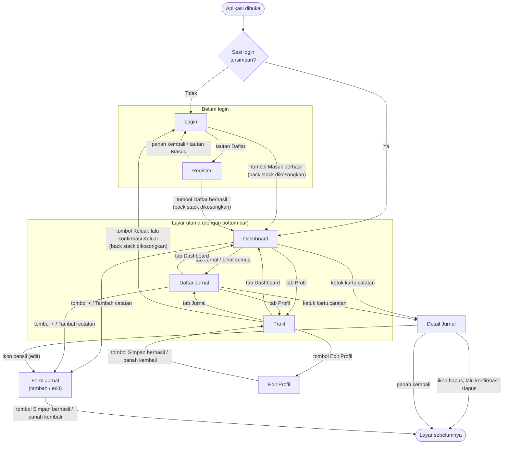

# Alur Navigasi — Jurnal Trading

Dokumen ini menjelaskan perpindahan antar layar berdasarkan kode di `app/src/main/java/com/example/jurnaltreding/ui/navigation/` (`NavGraph.kt`, `Routes.kt`, `BottomBar.kt`, `SessionViewModel.kt`) pada commit `012205e`.

Aplikasi memakai satu `Activity` dan satu `NavHost` (Navigation Compose) dengan 8 layar:

| Layar | Rute | Bottom bar |
|---|---|---|
| Login | `login` | Tidak |
| Register | `register` | Tidak |
| Dashboard | `dashboard` | Ya |
| Daftar Jurnal | `journal_list` | Ya |
| Profil | `profile` | Ya |
| Detail Jurnal | `journal_detail/{entryId}` | Tidak |
| Form Jurnal (tambah/edit) | `journal_form?entryId={entryId}` | Tidak |
| Edit Profil | `edit_profile` | Tidak |

Form Jurnal adalah satu layar untuk dua keperluan: tanpa `entryId` berarti tambah catatan, dengan `entryId` berarti edit.

---

## 1. Diagram alur

"Layar sebelumnya" adalah layar yang membuka Detail atau Form: Dashboard, Daftar Jurnal, atau Detail Jurnal (jika Form dibuka dari ikon pensil).

---

## 2. Tabel perpindahan

Kolom "Tombol back" menjelaskan apa yang terjadi jika tombol back sistem ditekan **di layar tujuan**.

### Sebelum login

| Layar asal | Aksi | Layar tujuan | Tombol back di layar tujuan |
|---|---|---|---|
| (aplikasi dibuka) | Sesi tidak ada | Login | Keluar dari aplikasi |
| (aplikasi dibuka) | Sesi tersimpan | Dashboard | Keluar dari aplikasi |
| Login | Tautan **Daftar** | Register | Kembali ke Login |
| Register | Panah kembali atau tautan **Masuk** | Login | Keluar dari aplikasi |
| Login | Tombol **Masuk**, login berhasil | Dashboard | Keluar dari aplikasi (tidak kembali ke Login) |
| Register | Tombol **Daftar**, pendaftaran berhasil | Dashboard | Keluar dari aplikasi (tidak kembali ke Register atau Login) |

Jika login atau pendaftaran gagal (validasi, password salah, email sudah terdaftar), tidak ada perpindahan: pesan error tampil di layar yang sama.

### Layar utama (bottom bar)

| Layar asal | Aksi | Layar tujuan | Tombol back di layar tujuan |
|---|---|---|---|
| Dashboard, Jurnal, atau Profil | Tab **Dashboard** | Dashboard | Keluar dari aplikasi |
| Dashboard, Jurnal, atau Profil | Tab **Jurnal** | Daftar Jurnal | Kembali ke Dashboard |
| Dashboard, Jurnal, atau Profil | Tab **Profil** | Profil | Kembali ke Dashboard |
| Dashboard | Tautan **Lihat semua** | Daftar Jurnal (sama seperti tab Jurnal) | Kembali ke Dashboard |

Mengetuk tab yang sedang aktif tidak membuka salinan baru (`launchSingleTop`).

### Jurnal

| Layar asal | Aksi | Layar tujuan | Tombol back di layar tujuan |
|---|---|---|---|
| Dashboard atau Daftar Jurnal | Tombol **+**, atau tombol **Tambah catatan** di state kosong | Form Jurnal (tambah) | Kembali ke layar asal, isian dibuang |
| Dashboard atau Daftar Jurnal | Ketuk kartu catatan | Detail Jurnal | Kembali ke layar asal |
| Detail Jurnal | Ikon pensil | Form Jurnal (edit) | Kembali ke Detail, perubahan dibuang |
| Form Jurnal | Tombol **Simpan**, berhasil | Layar yang membuka form | Sesuai layar itu |
| Form Jurnal | Panah kembali | Layar yang membuka form | Sesuai layar itu |
| Detail Jurnal | Ikon hapus → konfirmasi **Hapus** | Layar yang membuka Detail | Sesuai layar itu |
| Detail Jurnal | Ikon hapus → **Batal** | Tetap di Detail | – |
| Detail Jurnal | Panah kembali | Layar yang membuka Detail | Sesuai layar itu |
| Detail atau Form (catatan tidak ditemukan) | Tombol **Kembali** di state kosong | Layar sebelumnya | Sesuai layar itu |

Jika Simpan gagal (validasi atau gagal menyimpan), tidak ada perpindahan.

### Profil

| Layar asal | Aksi | Layar tujuan | Tombol back di layar tujuan |
|---|---|---|---|
| Profil | Tombol **Edit Profil** | Edit Profil | Kembali ke Profil, perubahan dibuang |
| Edit Profil | Tombol **Simpan**, berhasil | Profil | Kembali ke Dashboard |
| Edit Profil | Panah kembali | Profil | Kembali ke Dashboard |
| Profil | Tombol **Keluar** → konfirmasi **Keluar** | Login | Keluar dari aplikasi (tidak kembali ke Profil) |
| Profil | Tombol **Keluar** → **Batal** | Tetap di Profil | – |

Aplikasi tidak memakai `BackHandler` khusus: tombol back sistem selalu berarti "tutup layar teratas di back stack". Karena itu tidak ada dialog "buang perubahan?" saat keluar dari form.

---

## 3. Aturan back stack dan rotasi layar

### Perpindahan antara alur login dan alur utama mengikuti sesi

Layar Login, Register, dan Profil tidak memanggil navigasi ke Dashboard atau Login secara langsung. Urutannya:

1. `LoginViewModel`, `RegisterViewModel`, atau `ProfileViewModel` mengubah sesi lewat `UserRepository` (id user disimpan ke atau dihapus dari DataStore).
2. `SessionViewModel` mengamati sesi itu dan mengeluarkan `LOGGED_IN` atau `LOGGED_OUT`.
3. `LaunchedEffect(isLoggedIn)` di `AppNavHost` (`NavGraph.kt`) bereaksi:
   - sesi menjadi login saat berada di Login/Register → pindah ke Dashboard;
   - sesi menjadi logout saat berada di layar mana pun selain Login/Register → pindah ke Login.

Kedua perpindahan memakai `navigateAndClearBackStack()`, yaitu `popUpTo(graph.id) { inclusive = true }`: seluruh back stack dibuang sebelum layar baru dibuka.

Akibatnya:

- **Setelah login, tidak bisa kembali ke Login.** Back stack hanya berisi Dashboard, jadi tombol back menutup aplikasi.
- **Setelah logout, tidak bisa kembali ke dalam aplikasi.** Back stack hanya berisi Login, jadi tombol back menutup aplikasi.

### Layar awal

Saat aplikasi dibuka, `JurnalApp` menampilkan "Menyiapkan aplikasi..." sampai sesi selesai dibaca dari DataStore. Setelah itu `startDestination` ditetapkan satu kali: Dashboard jika ada sesi, Login jika tidak. Pengguna yang masih login tidak pernah melihat layar Login.

### Bottom bar

Pindah tab memakai `navigateToTopLevel()`:

- `popUpTo(Routes.DASHBOARD) { saveState = true }`: back stack dipangkas sampai Dashboard, sehingga isinya paling banyak Dashboard + satu tab. Karena itu tombol back dari Jurnal atau Profil selalu ke Dashboard, dan dari Dashboard keluar aplikasi.
- `launchSingleTop = true`: tidak ada salinan ganda dari tab yang sama.
- `restoreState = true`: state tab yang ditinggalkan dipulihkan saat tab itu dibuka lagi.

Bottom bar hanya tampil jika rute saat ini adalah Dashboard, Daftar Jurnal, atau Profil. Di Detail, Form, dan Edit Profil bottom bar disembunyikan, sehingga jalan keluar dari layar itu hanya panah kembali, tombol back, atau menyelesaikan aksinya.

### Rotasi layar

Rotasi membuat ulang `Activity`, tetapi state berikut bertahan:

| Yang bertahan | Disimpan di | Contoh |
|---|---|---|
| Posisi navigasi dan back stack | `rememberNavController()` | Tetap di layar yang sama setelah rotasi |
| Layar awal | `rememberSaveable` di `AppNavHost` | Tidak dihitung ulang |
| Data dan status layar | `ViewModel` per layar, diekspos sebagai `StateFlow<UiState>` | Daftar jurnal, statistik, pesan error validasi, status menyimpan |
| Teks yang sedang diketik | `rememberSaveable` di Composable | Isi form jurnal, form Login/Register, Edit Profil, kolom pencarian |
| Status tampilan kecil | `rememberSaveable` | Dialog konfirmasi yang sedang terbuka, date picker, tombol tampilkan password |
| Filter daftar jurnal | `JournalListViewModel` | Chip Semua/Open/Closed |

`ViewModel` dibuat per entri back stack (lewat `viewModel()` di dalam `composable { }`), jadi setiap layar di back stack punya state sendiri dan dibuang saat layarnya ditutup.

---

## Status pengujian

Yang sudah dijalankan di emulator:

- Login → Dashboard, lalu back keluar aplikasi (tidak ke Login).
- Logout → Login, lalu back keluar aplikasi (tidak ke Profil).
- Sesi tersimpan: setelah force stop, aplikasi langsung membuka Dashboard.
- Register berhasil → Dashboard; Login ↔ Register.
- Tab bottom bar, tombol +, kartu → Detail → Form edit → Simpan → Detail, dan hapus → layar sebelumnya.
- Profil → Edit Profil → Simpan → Profil.
- Rotasi di Form Jurnal: isi field dan pesan error tetap ada.

Dua pengujian back stack (setelah login dan setelah logout) dan pengujian rotasi dilakukan saat aplikasi masih memakai data contoh di memori; kode navigasinya tidak berubah sejak itu.

Yang ditulis berdasarkan kode dan belum diuji di emulator:

- Tombol back dari tab Jurnal atau Profil kembali ke Dashboard.
- State tab dipulihkan saat pindah tab bolak-balik.
- Rotasi di layar selain Form Jurnal.
- Tombol back sistem di Register dan Detail (di kedua layar itu yang diuji adalah panah kembali di top bar; di Form dan Edit Profil tombol back sistem sudah diuji).
